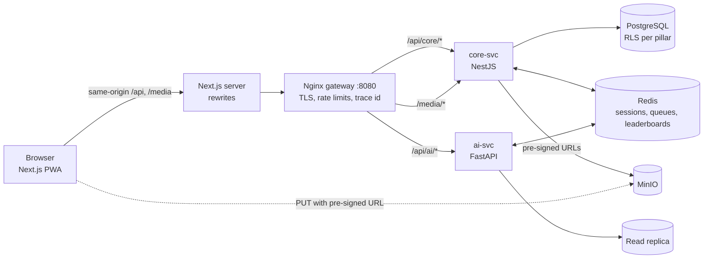

# Backend handoff

This frontend is complete and runs today on an in-browser mock database. Your job on the backend is to implement the endpoints it already calls. Nothing in the UI needs to change: flip one environment variable and the same screens talk to your services.

- **Endpoint reference:** [`API_ENDPOINTS.md`](./API_ENDPOINTS.md), generated from the code, with method, path, roles, request and response types, SRS ids and events. A machine-readable copy is in [`api-endpoints.json`](./api-endpoints.json).
- **Types:** the request and response shapes are TypeScript interfaces in `lib/types.ts` and in each service file under `lib/api/services/`. NestJS can import them directly; for FastAPI, mirror them as Pydantic models.
- **Behaviour reference:** each endpoint's mock handler, in the same service file, shows exactly what the UI expects: filtering, validation errors, state changes and role scoping. Read it like a spec.

## 1. Run it

```bash
npm install
npm run dev              # mock mode, no backend needed: http://localhost:3000
npm run api:docs         # regenerate docs/API_ENDPOINTS.md after changing a service file
```

To run against your services:

```bash
cp .env.example .env.local
# set NEXT_PUBLIC_API_MODE=live and API_GATEWAY_INTERNAL_URL=http://localhost:8080
npm run dev
```

Or run the whole stack (web, Nginx gateway, core-svc, ai-svc, Postgres, Redis, MinIO) with [`infra/docker-compose.yml`](../infra/docker-compose.yml). Point the `core-svc` and `ai-svc` `build.context` at your repositories first.

## 2. Architecture



- **core-svc** owns transactional data: identity, LMS, certificates, schedule, pitch, agri-market, capacity building (bookings, invoices), authoring, milestones, competitions, judging, governance, notifications.
- **ai-svc** owns computed data: KPIs and M&E metrics, course recommendations, needs assessment scoring, pitch routing and aggregate scores, reporting and evaluation exports. It reads from the replica and consumes events from core-svc.
- The gateway routes on the path prefix only. Services receive the full path, for example `/api/core/lms/enrollments/me`.

## 3. Where things live in this repo

| Path | What it is |
| --- | --- |
| `lib/api/config.ts` | Mode switch, gateway URL, service prefixes |
| `lib/api/http.ts` | Fetch wrapper: auth header, refresh on 401, trace id, idempotency key, error parsing, pre-signed upload |
| `lib/api/define.ts` | `defineEndpoint`, the registry the docs are generated from, `Page<T>` |
| `lib/api/services/core/*.ts`, `lib/api/services/ai/*.ts` | One file per domain. Every call the UI makes is declared here |
| `lib/api/mock/*` | The mock database the handlers use. Seed data for your fixtures |
| `lib/types.ts` | Shared domain types named after the SRS data model |
| `lib/session.tsx` | Session handling (token in memory, refresh cookie) |
| `infra/` | Gateway config and docker-compose for the full stack |

## 4. Contract conventions

### Base paths
`/api/core/...` for core-svc and `/api/ai/...` for ai-svc, both behind the gateway. All JSON. Dates are ISO 8601 in UTC (`2026-10-27T16:00:00Z`) or plain dates (`2026-10-27`) where the field is a day. Money is an integer amount with a `currency` field (RWF unless stated). Ids are UUIDs, except human-facing codes such as `SPA-INV-2026-0031`, `PITCH-2026-00417` and certificate codes.

### Authentication (SRS NFR-SEC.3)
1. `POST /api/core/auth/login`, `/auth/verify` and `/auth/oauth/google` return `{ accessToken, user }` in the body and set the refresh token as an `httpOnly; Secure; SameSite=Lax` cookie scoped to `/api/core/auth`.
2. The frontend keeps the access token in memory only and sends `Authorization: Bearer <token>`. Default lifetime 15 minutes.
3. On any `401`, the frontend calls `POST /api/core/auth/refresh` once (cookie only, no body) and retries. Rotate the refresh token on every refresh and denylist the old one in Redis.
4. On page load the frontend calls `/auth/refresh` then `GET /auth/me`. `me` must return `role`, plus `pillarId` for pillar representatives and `orgId` for organisation clients.

### Headers the frontend sends
| Header | Meaning |
| --- | --- |
| `Authorization` | Bearer access token |
| `Accept-Language` | `en` or `fr` (Kinyarwanda planned). Localise messages, emails and certificate PDFs |
| `X-Trace-Id` | UUID per request. Log it and pass it to downstream calls and events (NFR-MAINT.1) |
| `Idempotency-Key` | UUID on every write. Store key + response for 24 hours and return the stored response on a repeat. Endpoints marked **Offline** are replayed by the PWA after reconnecting, so this is required there |

### Errors
Return this envelope with a matching HTTP status. The UI shows `message` to the user, so write it for people and localise it.

```json
{ "error": { "code": "validation_failed", "message": "Summary must be 1,500 characters or fewer", "details": { "summary": "too_long" }, "traceId": "..." } }
```

Use `400 validation_failed` with field details, `401 unauthenticated`, `403 forbidden`, `404 not_found`, `409` for state clashes (for example submitting a locked pitch), `410` for things that have ended and `422` when a valid request cannot be applied (for example publishing an incomplete course). The specific codes the UI already handles are listed in [section 8](#8-error-codes-the-ui-handles).

### Pagination (NFR-BW.5)
Endpoints marked **Paged** take `?page=1&pageSize=20` and return `{ items, page, pageSize, total }`.

### File uploads (SRS FR-A3.3, FR-A3.6, NFR-SEC.11)
1. The client asks core-svc for an upload URL (`kind`, `fileName`, `contentType`, `sizeBytes`). Validate type and size there.
2. core-svc returns `{ uploadUrl, fileId, expiresAt }`: a MinIO pre-signed PUT URL into a quarantine prefix, valid for 15 minutes.
3. The browser PUTs the file directly to MinIO. Files never pass through the app servers.
4. A worker scans the file and promotes it to the retrievable prefix. The file's `scan` status moves from `pending` to `clean` (or `rejected`). The UI polls the entry and shows the state.
5. Downloads go through `/media/...`, where core-svc checks access and redirects to a pre-signed GET URL valid for 60 minutes.

### Language
Store the user's preferred language on the profile. Prefer it over `Accept-Language` for emails and certificates. Content that comes from data (course titles, KPI names, milestone titles, catalogue descriptions) is shown as received, so return it in the requested language where a translation exists.

## 5. Who can do what

The frontend hides what a role cannot use, but **the backend is the authority**. Enforce every rule below at the API layer, and enforce pillar isolation in PostgreSQL row-level security as well (FR-B1.3, FR-B1.4).

| Role | Portal | Scope |
| --- | --- | --- |
| `beneficiary` | `/app` | Own enrolments, progress, certificates, pitches, listings and profile only. Never sees judge identities or raw scores |
| `org_client` | `/org` | Own organisation's assessment, bookings, invoices, profile and users only |
| `pillar_rep` | `/console` | Rows where `pillar_id` equals their assigned pillar. Young Startups oversight and coaching catalogue as noted per endpoint |
| `judge_mentor` | `/judge` | Only entries routed to them, always anonymised (NFR-SEC.9). Other judges' scores only after submitting their own (FR-B2.5) |
| `executive_admin` | `/admin` | Everything, bypassing RLS. Log every cross-pillar read to the append-only audit log (FR-B1.6) |
| `board_auditor` | `/board` | Read-only, SELECT grants only, published reports and aggregates only (FR-B1.8) |

New staff accounts (pillar reps and judges) start as `pending_approval` and cannot sign in until the Executive Office approves them (FR-B1.7).

## 6. Events

Publish domain events on the Redis/BullMQ bus after the database change commits. The list, with the endpoints that emit each one, is at the end of [`API_ENDPOINTS.md`](./API_ENDPOINTS.md#domain-events). ai-svc consumes them to update skill progress, KPIs, routing and leaderboards (SRS 2.3).

## 7. Going live, step by step

1. Read `API_ENDPOINTS.md` and pick a domain, for example `identity` then `lms`.
2. Implement its endpoints with the same paths, shapes and rules. The mock handler next to each declaration shows the expected behaviour.
3. Seed your database from `lib/api/mock/*` so screens look the same as the demo.
4. Run the frontend with `NEXT_PUBLIC_API_MODE=live`, sign in, and walk through the portal that uses that domain.
5. Repeat per domain. Until every domain is live, keep developing in mock mode; the switch is global.

Adding or changing an endpoint (frontend side): edit the declaration in the service file, keep the mock handler working, run `npm run api:docs`, and commit the regenerated docs with the change.

## 8. Error codes the UI handles

The UI shows `message` as written, so keep these codes and send a human message in the request's language. `…` marks a value filled in at runtime.


### Validation (400)

| Code | Example message | Domain |
|---|---|---|
| `comment_too_short` | Write at least … characters of feedback | judging |
| `consent_required` | Data processing is needed to keep an account. Request deletion instead. | profile |
| `description_required` | Add a description | capacityAdmin |
| `details_required` | Describe the conflict in a few words | judging |
| `empty_message` | Please write a message | agrimarket |
| `file_too_large` | The limit is … MB | pitch |
| `incomplete` | Please complete every section and wait for the security scan | assessment, lms, pitch |
| `incomplete_rubric` | Score every criterion before submitting | judging |
| `invalid_amount` | The amount cannot be negative | pitch |
| `invalid_attempts` | Attempts must be between 1 and 10 | governance |
| `invalid_email` | Enter a valid billing email | capacity |
| `invalid_end` | The end date must be after the start date | capacity |
| `invalid_file_type` | Please choose a … file | pitch |
| `invalid_format` | Include {SEQ} so numbers are unique | governance |
| `invalid_hours` | Support hours must be zero or more | authoring, governance |
| `invalid_kind` | Unknown file kind | capacityAdmin, pitch |
| `invalid_listing` | Please add a title, a quantity and a price | agrimarket |
| `invalid_min_age` | Minimum age must be between 10 and 30 | governance |
| `invalid_minutes` | Lesson "…" must last between 1 and 240 minutes | authoring |
| `invalid_name` | Use 3 to 80 characters | governance, profile |
| `invalid_participants` | Add at least one participant | capacity |
| `invalid_pass_mark` | Pass mark must be between 1 and 100% | authoring, governance |
| `invalid_phase` | Phase must be between 1 and 6 | milestones |
| `invalid_price` | Price must be zero or more | governance |
| `invalid_programme` | Pick a programme of your pillar | authoring |
| `invalid_quarter` | Pick a quarter from the plan period | milestones |
| `invalid_sla` | Deletion SLA must be between 1 and 90 days | governance |
| `invalid_start` | The start date must be today or later | capacity |
| `invalid_terms` | Payment terms must be between 0 and 120 days | governance |
| `invalid_upload_limit` | Upload limits must be between 1 and 200 MB | governance |
| `invalid_vat` | VAT must be between 0 and 50% | governance |
| `invalid_year` | Evaluations are in 2031 and 2036 | reporting |
| `invalid_youth_age` | Youth upper age must be between 18 and 40 | governance |
| `language_required` | English cannot be turned off | governance |
| `languages_required` | Pick at least one language | capacityAdmin |
| `location_required` | Tell us where to deliver the training | capacity |
| `mode_unavailable` | … delivery is not available for every topic you chose | capacity |
| `modes_required` | Pick at least one delivery mode | capacityAdmin |
| `name_required` | Enter the organisation name | capacity |
| `no_topics` | Choose at least one topic | capacity |
| `not_a_quiz` | This lesson is not a quiz | lms |
| `not_confirmed` | Confirm the declaration to continue | judging |
| `note_too_long` | Keep the note under 1000 characters | milestones |
| `pillar_required` | Choose a pillar | authoring, metrics |
| `quiz_requires_pass` | Pass the quiz to complete this lesson | lms |
| `reason_required` | Choose a reason | capacity, judging |
| `score_out_of_range` | Scores must be whole numbers from … to … | judging |
| `sequence_backwards` | The sequence can only move forward | governance |
| `summary_too_long` | Keep the summary under … characters | pitch |
| `team_too_large` | A team has 1 to … people | pitch |
| `title_required` | Give the course a title of at least 5 characters | authoring, capacityAdmin |
| `title_too_long` | Keep the title under 120 characters | authoring, capacityAdmin, milestones |
| `title_too_short` | Give the milestone a clear title of at least 5 characters | milestones |
| `too_many_topics` | The … package covers up to … topics | capacity |
| `unknown_criterion` | Unknown criterion "…" | judging |
| `unknown_package` | Choose a package | capacity |
| `unknown_topic` | Topic … is not available | capacity |

### Not signed in (401)

| Code | Example message | Domain |
|---|---|---|
| `unauthenticated` | Please sign in | identity, profile |

### Not allowed (403)

| Code | Example message | Domain |
|---|---|---|
| `no_organisation` | Your account is not linked to an organisation | assessment, capacity |
| `no_pillar` | Your account is not linked to a pillar | authoring, metrics, milestones |
| `not_enrolled` | Enrol in this course to open its lessons | lms |
| `not_owner` | You can only remove your own listings | agrimarket |
| `other_pillar` | This course belongs to another pillar | authoring, metrics |
| `score_not_submitted` | Submit your own score to see the other judges | judging |

### Not found (404)

| Code | Example message | Domain |
|---|---|---|
| `certificate_not_found` | We could not find this certificate | certificates |
| `course_not_found` | This course is not available | authoring, catalog, lms |
| `cycle_not_found` | This competition cycle does not exist | competitions, evaluation, judging |
| `entry_not_found` | We could not find this pitch | capacityAdmin, pitch |
| `lesson_not_found` | We could not find this lesson | lms |
| `listing_not_found` | This listing is no longer available | agrimarket |
| `not_assigned` | This entry is not in your queue, or you have been recused from it | judging |
| `not_enrolled` | You are not enrolled in this course | lms |
| `not_found` | Staff request not found | capacity, governance, reporting |
| `session_not_found` | We could not find this session | schedule |
| `upload_not_found` | We could not find this upload | pitch |

### Conflicting state (409)

| Code | Example message | Domain |
|---|---|---|
| `already_member` | This person is already on your list | capacity |
| `already_published` | This course is already published | authoring, reporting |
| `already_submitted` | This score is already submitted | judging |
| `attempts_exhausted` | You have used all your attempts for this quiz | lms |
| `cannot_remove` | This user cannot be removed | capacity |
| `cycle_closed` | This competition is no longer taking entries | pitch |
| `duplicate_programme` | This pillar already has a programme with that name | governance |
| `entry_exists` | You already have an entry in this competition | pitch |
| `entry_locked` | This pitch has been submitted and can no longer change | pitch |
| `invalid_state` | This request has already been decided | capacityAdmin, competitions, governance |
| `not_cancellable` | Only pending bookings can be cancelled. Contact our team to change a confirmed booking. | capacity |
| `not_published` | This course is already a draft | authoring |
| `not_reschedulable` | This booking can no longer be moved | capacity |
| `not_submitted` | This pitch has not been submitted yet | pitch |
| `results_not_published` | Results for this cycle are not published yet | competitions |
| `stale_questionnaire` | The questionnaire changed. Please reload and answer again. | assessment |
| `too_early` | This session opens 15 minutes before it starts | schedule |

### Gone (410)

| Code | Example message | Domain |
|---|---|---|
| `session_ended` | This session has ended | schedule |

### Cannot be processed (422)

| Code | Example message | Domain |
|---|---|---|
| `not_publishable` | A published course must stay complete. Fix the highlighted items or unpublish first. | authoring |

